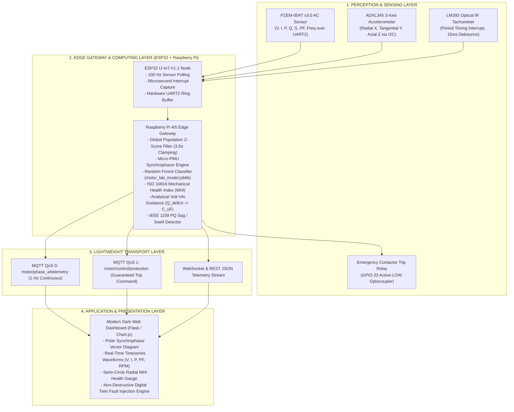

# Grid Pulse: Edge AI Predictive Maintenance & Smart Grid Monitoring


%20%7C%20WebSockets%20%7C%20UART-orange.svg)
-brightgreen.svg)


**Grid Pulse** is a grid-interactive, edge-computed industrial asset intelligence and predictive maintenance platform engineered for three-phase induction machinery (validated on a **PSG 2.2 kW / 3.0 HP industrial testbed**). 

The platform unifies **micro-PMU synchrophasor analytics** ($|V|, |I|, \theta, \text{RoCoF}$), **ISO 10816 mechanical vibration health indexing**, **Random Forest edge machine learning**, and **automated protective relay tripping** with real-time web supervisory control and a digital twin fault-injection benchmark engine.

---

## 🏛️ System Architecture



---

## ⚡ Core Technical Features

### 1. High-Precision Micro-PMU Synchrophasor Decomposition
Extracts sub-second distribution grid metrics directly at the motor feeder terminals:
* **Voltage & Current Phasors:** Instantaneous magnitude $|V|, |I|$ and phase displacement angle $\theta = \arccos(\text{PF})$.
* **Active, Reactive & Apparent Power:** Simultaneous calculation of $P$ (Watts), $Q$ (VAr), and $S$ (VA).
* **Rate of Change of Frequency ($\text{RoCoF}$):** Continuously computes $\frac{df}{dt}$ ($\text{Hz/s}$) across a sliding window to detect grid islanding, generation loss, and supply transients.

### 2. Edge Signal Conditioning via Global Population Z-Score Statistics
Before passing to machine learning or health indexing, raw telemetry is conditioned using precomputed parameters from a **14,000-sample baseline laboratory dataset** (`motor_cleaned_raw_timeseries.csv`):
* **Z-Score Outlier Clamping:** Identifies electrostatic or transient artifacts where $|Z| > 3.5$:
  $$Z = \frac{x_t - \mu_{\text{pop}}}{\sigma_{\text{pop}}}$$
  Clamped cleanly to $x_{\text{clamped}} = \mu_{\text{pop}} \pm 3.5 \cdot \sigma_{\text{pop}}$.
* **Exponential Moving Average (EMA):** Applied with smoothing coefficient $\alpha = 0.25$ to suppress high-frequency line noise.

### 3. Edge Machine Learning Load State Classification
* **Algorithm:** Random Forest Classifier (40 estimators, max depth 10, multi-threaded).
* **Feature Extraction:** 23 statistical, time-domain, and physical features extracted over 1-second sliding windows (50% overlap).
* **Classification Classes:** `No_Load` (0 kg brake), `Load_1_2kg` (2 kg belt load), `Load_2_7.5kg` (7.5 kg heavy load).
* **Validation Accuracy:** **100.00% 5-fold cross-validation** on real motor laboratory datasets.

### 4. ISO 10816 Mechanical Health Indexing (MHI)
Combines electrical and mechanical degradation into a composite health index ($0\text{--}100\%$):
* **Electrical Health Index (EHI):** Evaluates thermal loading, voltage unbalance, and current deviation against rated FLA.
* **Vibration Health Index (VHI):** Maps triaxial RMS vibration velocity against ISO 10816-3 Class II limits ($< 1.4\text{ mm/s}$ Good, $> 4.5\text{ mm/s}$ Danger).
* **Kinematic Health Index (KHI):** Detects slip anomalies ($s = \frac{N_s - N_r}{N_s}$) and shaft rotational instability.

### 5. Analytical Volt-VAr Guidance & Power Factor Optimization
Calculates exact corrective reactive compensation without expensive hardware capacitor switching:
$$Q_{\text{deficit}} = P \cdot \left(\tan(\arccos(\text{PF}_{\text{current}})) - \tan(\arccos(\text{PF}_{\text{target}}))\right)$$
$$C_{\mu\text{F}} = \frac{Q_{\text{deficit}}}{2\pi \cdot f \cdot V^2} \times 10^6$$

### 6. Digital Twin Fault-Injection Engine
Non-destructively validates protective trip logic without risking physical asset destruction:
* **Injectable Faults:** Severe Voltage Sag ($0.65\text{ p.u.}$), Swell ($1.25\text{ p.u.}$), Single Phasing / Phase Loss, Mechanical Rotor Jam / Overload, Bearing Vibration Resonance, High RoCoF Grid Islanding.
* **Latched Safety Trip:** Automatic contactor actuation (GPIO 23) executed in $< 15\text{ ms}$ upon safety envelope violation with manual operator reset latching.

---

## 🔌 Hardware Wiring & Pin Mapping

Target Board: **ESP32 `IJ-IoT-V1.1` Development Board**

| Peripheral / Sensor | Header / Pin | Protocol | Technical Description |
| :--- | :--- | :--- | :--- |
| **PZEM-004T v3.0** | Header P9 (`GPIO 16` RX2, `GPIO 17` TX2) | Hardware UART2 | Optically isolated AC voltage ($80\text{--}260\text{V}$), current ($0\text{--}100\text{A}$ CT), active power, frequency, PF |
| **ADXL345 Accelerometer** | Header P2/P3 (`3V3, GND, GPIO 22 SCL, GPIO 21 SDA`) | I2C (`0x53`) | Triaxial acceleration $\pm 16\text{g}$ at $100\text{ Hz}$ data rate |
| **LM393 Optical Tachometer** | Header P9 (`GPIO 18`) | Hardware Interrupt | Falling-edge period timing with $15\text{ ms}$ microsecond software debounce |
| **Emergency Trip Relay** | Header P9 (`GPIO 23`) | Digital Output | Active-LOW optocoupled relay driving main 3-phase motor contactor coil |
| **Power Bus** | Header P10 (`5V`, `GND`) | Power Rail | Dedicated supply for PZEM optocoupler logic and sensors |

---

## 🖥️ Live Web Dashboard

The local edge web dashboard (Port 5000) provides real-time supervisory visibility:
* **Polar Synchrophasor Scope:** Visualizes $|V|$ and $|I|$ vector magnitudes with real-time phase displacement angle $\theta$.
* **Radial Semi-Circle MHI Gauge:** Instant status indication (Healthy $>85\%$, Warning $60\text{--}85\%$, Critical $<60\%$).
* **Live Telemetry Stream:** Timeseries charts updating at 1 Hz for voltage, current, true power, power factor, frequency, and RPM.
* **Interactive Control & Fault Injection Console:** One-click simulation of electrical and mechanical faults to benchmark safety trip response times.

---

## 📂 Repository Structure

```text
Grid-Pulse-Edge-AI-Predictive-Maintenance/
├── pzem_reader/
│   └── pzem_reader.ino             # Production ESP32 firmware (PZEM UART2, Tachometer ISR, MQTT client)
├── web_dashboard/
│   ├── app.py                      # Flask edge gateway, WebSocket handler, and REST API
│   └── templates/
│       └── index.html              # Dark-themed industrial supervisory dashboard (Chart.js)
├── edge_filter_population.py       # Online global population Z-score and EMA filter
├── edge_single_phase_smartgrid.py  # Master edge processing, synchrophasor, MHI, and protection engine
├── fault_injection_engine.py       # Digital twin synthetic fault injection simulation
├── train_lab_model.py              # Machine learning training script (Random Forest 100% CV)
├── process_lab_dataset.py          # Feature extraction pipeline for laboratory timeseries
├── motor_lab_model.joblib          # Trained Random Forest serialized model artifact
├── motor_lab_metadata.json         # Feature list, scaling factors, and class boundaries
├── dataset_population_parameters.json # Precomputed population statistical parameters (N=14,000)
├── motor_cleaned_raw_timeseries.csv # Curated 14,000-sample baseline motor timeseries dataset
├── motor_training_features_dataset.csv # 23-feature extracted training dataset
├── .gitignore                      # Python build and OS ignore list
├── LICENSE                         # MIT License with Academic Integrity notice
└── README.md                       # Comprehensive platform documentation
```

---

## 🚀 Quick Start Guide

### 1. Flash the ESP32 Perception Node
1. Open [`pzem_reader/pzem_reader.ino`](pzem_reader/pzem_reader.ino) in Arduino IDE or VS Code / PlatformIO.
2. Configure your Wi-Fi credentials and Raspberry Pi MQTT broker IP:
   ```cpp
   const char* WIFI_SSID     = "YOUR_WIFI_SSID";
   const char* WIFI_PASSWORD = "YOUR_WIFI_PASSWORD";
   const char* MQTT_BROKER   = "192.168.1.100";
   ```
3. Flash to the `ESP32 Dev Module`. Verify Serial Monitor at 115200 baud for sensor initialization.

### 2. Start the Edge Gateway & Dashboard
On your Raspberry Pi or host workstation:
```bash
# Install Python dependencies
pip install flask flask-socketio paho-mqtt scikit-learn joblib numpy pandas

# Start the edge intelligence engine & web server
python web_dashboard/app.py
```
Open your browser and navigate to:
```text
http://localhost:5000
```

---

## ⚖️ Academic Integrity & License

This project is licensed under the [MIT License](LICENSE) with an Academic Integrity Notice.

> **Notice:** This repository is published strictly for educational, portfolio, and engineering demonstration purposes. Direct redistribution or submission of this work for university lab evaluations, coursework, or capstone assessments without proper authorization is prohibited by academic honesty policies.
